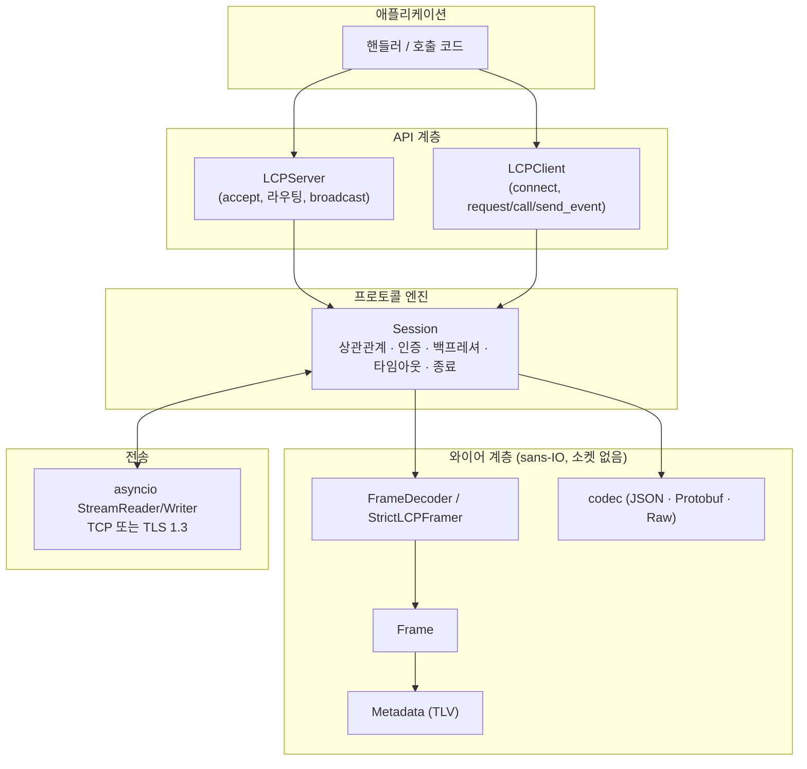
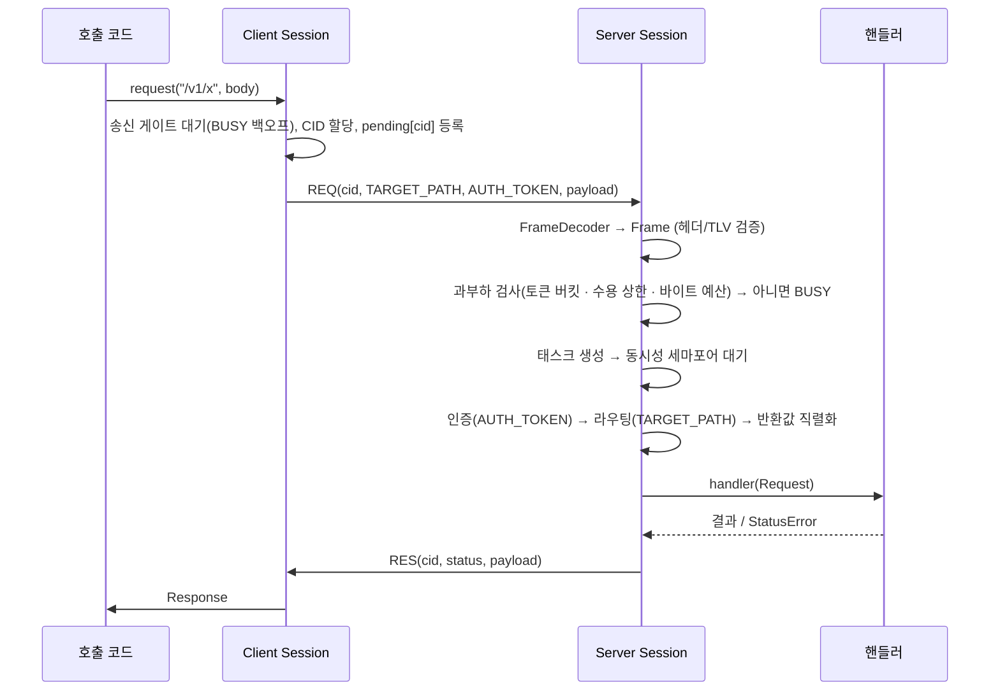

# 아키텍처

## 계층

| 계층 | 모듈 | 책임 | 소켓 필요 |
| :-- | :-- | :-- | :-: |
| 와이어 | `constants` `enums` `metadata` `frame` `framer` `codec` | 바이트 ↔ `Frame` 변환과 명세 §3–§6의 검증 | ✗ |
| 엔진 | `session` | 한 연결의 모든 동작(아래) | ✓ |
| API | `server` `client` `router` `message` | 사용자용 객체(`Request`/`Reply`/`Response`), 라우팅, 연결 수명 | ✓ |
| 보조 | `auth` `ratelimit` `tls` `cli` | 인증기, 토큰 버킷, SSL 컨텍스트, 명령줄 | — |

와이어 계층에는 I/O가 없으므로 어떤 전송(예: 테스트용 메모리 버퍼, 다른 이벤트 루프)에도 재사용할 수 있고, hypothesis로
임의의 청크 분할·쓰레기 입력을 검증합니다. `FrameDecoder`는 두 단계로 나뉩니다.

1. `next_raw()` — 헤더 검증(Magic · Version · Type · PING/PONG 길이 · 크기)만. 명세 §6 참조 프레이머와 동등.
2. `next_frame()` — Serializer 값과 TLV 메타데이터를 검증해 `Frame`을 만듦. 이 단계의 오류는 **비치명적**(프레임 경계는 이미
   확정되어 스트림은 동기화 상태)이라 `BAD_REQUEST`로 응답하고 계속 진행합니다.

## 한 요청의 흐름

## 동시성 모델 (연결당)

- **읽기 루프 1개**: 소켓에서 읽어 `FrameDecoder`에 넣고, 완성된 프레임을 동기적으로 분배합니다. `PING`→`PONG`, `RES`/`EVT_ACK`→대기 중인
  future 해제, `REQ`/`EVT`→과부하 검사 후 **요청당 태스크** 생성. 읽기 루프는 핸들러를 기다리지 않으므로 파이프라이닝이 가능합니다.
- **쓰기**: `asyncio.Lock` 하나로 직렬화하고, 쓰기 버퍼가 high-water를 넘으면 `drain()`을 `write_timeout`과 함께 기다립니다
  (느린 상대가 있어도 버퍼는 한 프레임 이상 쌓이지 않음). `PONG`/`BUSY`/오류 같은 소형 제어 프레임은 즉시 기록하되, 버퍼가
  `max_payload + 1 MiB`를 넘으면 연결을 중단합니다.
- **대기 중인 호출**: `pending[cid] = (future, 기대 메시지 타입)`. 응답이 없으면 `RequestTimeoutError`, 연결이 끊기면 모든 future가
  `ConnectionClosedError`로 해제됩니다. 늦게 도착한 응답은 조용히 버려집니다.
- **종료**: `close(grace)`는 새 호출을 `BUSY`로 거절하고 실행 중인 핸들러를 `grace`초 기다린 뒤 소켓을 닫습니다. 남은 태스크는 취소됩니다.

## 오류 처리 매트릭스

| 상황 | 감지 위치 | 응답 | 연결 |
| :-- | :-- | :-- | :-: |
| Magic 불일치 | `FrameDecoder` (2바이트 시점) | 없음 | 즉시 종료 |
| 지원하지 않는 Version | 헤더 | `BAD_REQUEST` (CID echo) | 종료 (lingering close) |
| 잘못된 Message Type, PING/PONG 길이 ≠ 0 | 헤더 | `BAD_REQUEST` | 종료 |
| 페이로드 > `max_payload` | 헤더(본문 수신 전) | `PAYLOAD_TOO_LARGE` | 종료 |
| 알 수 없는 Serializer, 잘못된 TLV | 프레임 완성 후 | `BAD_REQUEST` (`REQ`→`RES`, `EVT`→`EVT_ACK`) | 유지 (`max_bad_requests` 초과 시 종료) |
| `REQ`에 `TARGET_PATH` 없음/형식 오류 | 핸들러 단계 | `BAD_REQUEST` | 유지 |
| 라우트/이벤트 핸들러 없음 | 라우터 | `NOT_FOUND` | 유지 |
| 인증 실패 | 인증 단계(핸들러 실행 전) | `UNAUTHORIZED` | 연속 `max_auth_failures`회 시 종료 |
| 과부하 | 수용 단계 | `BUSY` + `retry_after_ms` | 유지 |
| 핸들러 예외 · 타임아웃 | 핸들러 단계 | `INTERNAL_ERROR` (상세 비노출) | 유지 |
| 응답을 인코딩할 수 없음(예: 16 MiB 초과) | 응답 생성 | `INTERNAL_ERROR` | 유지 |
| 상대가 읽지 않음 | 쓰기 버퍼 | 없음 | `write_timeout` / 버퍼 초과 시 중단 |
| 프레임이 끝나지 않음 | 읽기 루프 | 없음 | `frame_timeout` 후 종료 |
| 무통신 | 읽기 루프 | 없음 | `idle_timeout` 후 종료 |
| 연결 수 초과 | `LCPServer` | `BUSY` (CID 0) | 종료 |

## 확장 지점

- **직렬화**: `register_codec(serializer_id, codec)`로 교체/추가.
- **인증**: `(token) -> Principal | bool | None` 호출 가능 객체(동기/비동기).
- **전송**: `Session`은 `StreamReader`/`StreamWriter` 쌍만 필요하므로 Unix 소켓·다른 TLS 설정도 `asyncio`가 만들어 주는 스트림이면 사용 가능.
- **다른 언어 포트**: `docs/SPEC_COMPLIANCE.md`의 테스트 목록과 `tests/test_spec_conformance.py`의 골든 벡터를 그대로 이식하면 상호운용 검증 기준으로 쓸 수 있습니다.
